# QuakeAVP

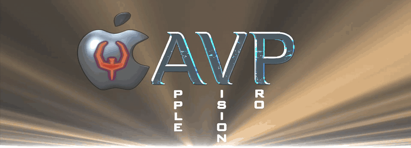

Quake for Apple Vision Pro: QuakeSpasm's engine core with a native Metal
renderer where OpenGL used to be, played with your hands.

**Status: first public alpha (0.1.0).** Built for the headset, not ported onto
it. No game data included — bring your own paks.

## See it

**Phase out and occlusion**

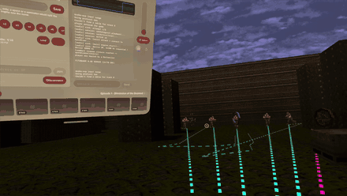

Phase melts the level into your room at the rate you set, in the color you set. Enemies and shots keep rendering through it, and occlusion still holds: what the level hides stays hidden. The invasion is now in your home!

**Weapon wheel**

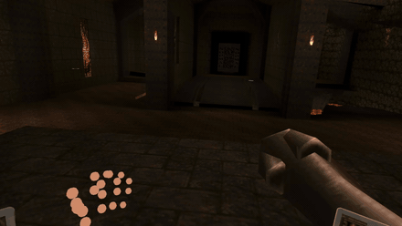

Twist the wrist over and the weapon wheel appears while time slows to a crawl, giving you time to choose. Point at a slot with your dominant hand, or enable same-hand selection to pick with the hand the wheel rides on; turn the palm back to finalize selection of weapon. The slow motion can be disabled if you prefer the original pacing and tempo of Quake.

**Hand viewing modes**

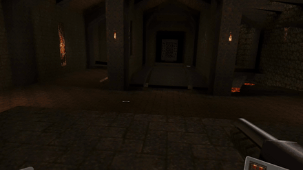

Your hands can render as nothing at all, as a wireframe debug skeleton of the joints (useful for checking mistriggers and calibration), as a 3D model, or as your real hands! Real hands have their own weapon model placement settings too. You can also show the 3D model on the off hand only, for better immersion and tracking of your non-gun hand.

**Teleportation**

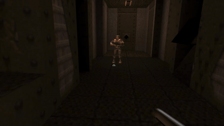

Point at the floor, watch the crosshair turn blue, pinch, release and blink there. The landing point is collision checked, so you never end up in a wall or in lava. Yes, you can telefrag.

**HUDs**

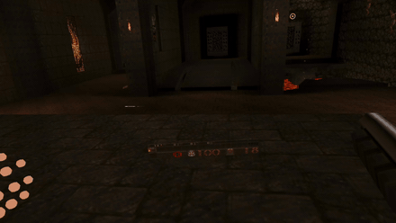

Choose from three distinct HUDs: the classic status bar ahead of you, the classic bar strapped to your wrist, or modular tiles unique to this port! Press Edit HUD Layout to edit the placement and size of the HUD elements.

**Power gauntlet**

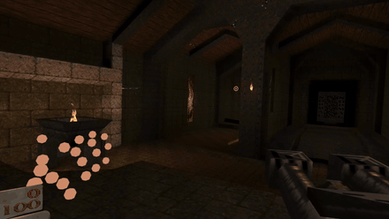

The power gauntlet: a six-key panel on the off forearm, hidden until you glance at it. Choose whether to wear it as an along-the-arm communicator or as a wrist-mounted device. Each key fires a console command, and a fingertip appears to guide the press only once the other hand is close to the panel. The final version will be customizable.

**Crosshair and laser**

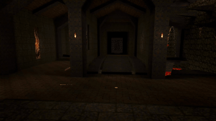

Choose a custom crosshair and change its color. Enable the health and ammo crosshair for an immersive resource display. Add a laser from the muzzle and pick its color too. Or go cold turkey, with no assistance of any kind!

**Your Quake, Your Way!**

## What is different about it

- A native **Metal renderer**, written directly against QuakeSpasm's own
  world, model and lightmap data.
- **Single-pass foveated stereo** at the drawable's native resolution, through
  vertex amplification.
- **Hand tracking as a first-class input** — the whole game plays with no
  controller at all.
- The head pose is **late-latched at encode** rather than waited on, so the
  engine and the compositor never block each other.
- The **body/aim split**, the **weapon wheel**, the **phase dissolve** and a
  **capture-and-export pipeline** — the gun goes where your arm points while
  the view stays with your body, the wheel rings your wrist in slow motion,
  the world dissolves to your room on command, and a session can be recorded
  and re-rendered offline to a `.mov`.

The goal for this port is to be the best native and most immersive Quake port
on Apple Vision Pro.

## Requirements

- An Apple Vision Pro running visionOS 26 or later.
- Your own Quake data — `pak0.pak` at minimum. See **Game data** below.
- A Mac with Xcode, for now. This is a sideload, not a store app.

## Controls

Bare hands are the primary input; a PSVR2 Sense pair takes over automatically
when one is attached. The tables below are the shipped bindings — the diagrams,
the one-line descriptions and the code they came from all live in
[`docs/media/gestures/manifest.json`](docs/media/gestures/manifest.json).

Diagrams are drawn for the default right-handed setting, so the **off hand** is
your left and the **gun hand** is your right. Comfort's **Dominant hand**
picker swaps both.

### Hands

| | | |
| --- | --- | --- |
| 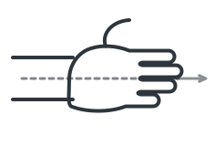 | **Aim** | The gun rides your dominant forearm and fires where the arm points, not where you look. The forearm is used rather than a finger so pinching, fisting or opening the hand never drops the aim. |
| 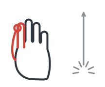 | **Fire** | Pinch thumb to index on the gun hand to shoot, and hold it for automatic fire. An index curl is the alternative trigger, carried on the input profile. |
| 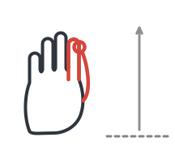 | **Walk forward** | Hold thumb to index on the off hand to walk forward. Forward is where you look; the gun's aim is factored out, so pointing it somewhere else never drags you (`vr_moverelative 0` walks the body's forward instead). |
| 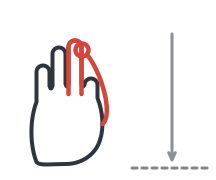 | **Walk backward** | Hold thumb to middle finger on the off hand to back up. |
| 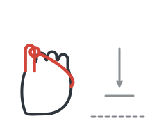 | **Crouch** | Hold thumb to little finger on the off hand to crouch; it is bound to `+movedown` and releases as soon as you let go. |
| 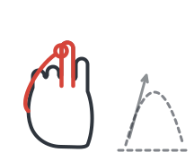 | **Jump** | Pinch thumb to ring finger on the gun hand to jump. Ring is the free finger there, since firing lives on the index. |
| 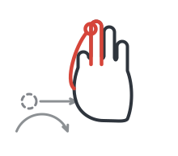 | **Turn** | Pinch thumb to middle finger on the gun hand and hold it out to one side: you keep turning for as long as you hold, faster the further you have dragged. With smooth turning off it fires one snap instead. |
| 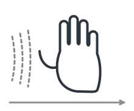 | **Quick turn** | A fast sideways whip of the un-pinched gun hand fires a single turn. The threshold is deliberately high, so ordinary aiming motion cannot trip it. |
| 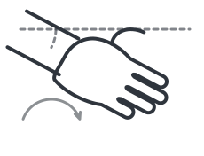 | **Body turn** | Hold the gun past about 18 degrees to one side and your body rotates under it, continuously, until you bring the aim back to center. It is the body that turns, not your neck: the aim leads and the view follows it round. |
| 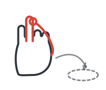 | **Teleport** | Point the gun at the floor, pinch thumb to ring on the off hand to line the spot up, and release to blink there. The landing point is collision-checked, so you cannot blink into a wall or into lava. |
| 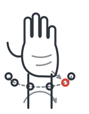 | **Weapon wheel** | Turn the off wrist over -- palm toward the floor, like checking a watch -- and your owned weapons ring that wrist while the world slows to a crawl. Reach the off hand toward one to highlight it, or point at the ring with the gun hand instead; turn the palm back up to take it. |
| 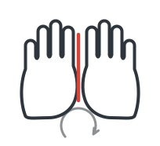 | **Summon the window** | Hold both palms together with the fingers up for 0.6 seconds and the app window comes back without leaving the game. The prayer sign is used because visionOS reserves the open palm for Home View. |
| 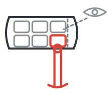 | **Power gauntlet** | Glance down at your off forearm and a six-key panel fades in; touch a key with the other index fingertip to fire it. `MENU`, the sixth key, summons the window. |
| 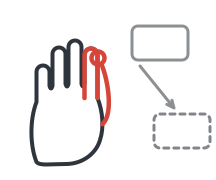 | **Move a HUD tile** | Press **Edit HUD Layout** in the window, then pinch a status tile with either hand and drag it where you want it. Every other gesture is suppressed while you are arranging, so you cannot fire or walk off the anchor. |

### PSVR2 Sense

No diagrams for these: a schematic of the controller pair would say less than
the names on its own buttons. Left is the movement hand, right is the aim hand.

| Control | Action | |
| --- | --- | --- |
| Left stick | Move | Walks where you look, with the aim factored out. |
| Right stick | Turn | Rotate the body. Smooth by default; snap in 45 degree steps with `vr_smoothturn 0`. |
| Left trigger | Run | Bound to `+speed`, so it runs unless `cl_alwaysrun` is on, in which case it walks. |
| Right trigger | Fire | Bound to `+attack`. Suppressed while the weapon wheel is open. |
| Left grip (L1) | Weapon wheel | Hold to open the ring, aim at a weapon, release to take it. It never reaches the engine as a key. |
| Left stick click (L3) | Slow motion | Toggles slow motion, routed straight to the engine rather than through a key. |
| Square / X | Previous weapon | `impulse 12`. |
| Triangle / Y | Next weapon | `impulse 10`. |
| Create / Share | Recenter | Runs `vr_recenter` directly, so it works even with a wiped config. |
| Cross, or right grip (R1) | Jump | Both are wired to `+jump`. |
| Circle | Use | Bound to `+use`. |
| Right stick click (R3) | Recenter | Bound to `vr_recenter`. |
| Options / Menu | Summon the window | Hand-agnostic on purpose, so swapping controller hands cannot remove the only Sense route into the menu. |

A classic Bluetooth gamepad happens to map onto the same virtual pad — an
inheritance from early development, before hands and the Sense pair existed.
It is not part of the supported input set and goes untested.

## Install

There will be no App Store build: GPL-2.0 is widely held to be incompatible
with the App Store's terms (the FSF's position, and what got VLC pulled from
the Store in 2011). Distribution here is sideload-only. Both routes below
install to a device you own.

### From source

```sh
brew install xcodegen
git clone https://github.com/Ywach404/QuakeAVP.git
cd QuakeAVP
make gen                 # XcodeGen -> QuakeAVP.xcodeproj
open QuakeAVP.xcodeproj
```

In Xcode, select the **QuakeAVP** target → Signing & Capabilities and set
**Team** to your own. The `DEVELOPMENT_TEAM` tracked in `project.yml` is mine;
replace it there if you would rather not re-set it after every `make gen`.
Then connect the headset and Run.

The scheme deliberately launches **without** the debugger attached
(`debugEnabled: false`). lldb ptraces the process and disrupts the audio and
compositor XPC. With the debugger on you get silence, and sometimes an
immersive space that never finishes loading. Neither is a bug in the app.

### From a release `.ipa`

Tagged builds attach an **unsigned** `.ipa` to the GitHub release. Unsigned
because a build signed with my certificate installs on my devices and nobody
else's; sign it with your own team using whichever sideload tool you prefer.

The same artifact, built here:

```sh
make ipa                 # -> build/QuakeAVP.ipa
```

If you sign with a **free** Apple ID rather than a paid developer account the
install expires after 7 days and has to be re-signed. That is Apple's limit on
free provisioning, not something this project can work around.

## Game data

Not included and never will be. `pak0.pak` and `pak1.pak` are id Software's
property; the engine is GPL, the assets are not.

Copy your `id1` folder into the app's Documents directory over the Files app —
the app appears there as **QuakeAVP** — then relaunch. The app checks for
`Documents/id1/pak0.pak` before booting and explains itself if it is missing,
rather than letting the engine `Sys_Error` out, which takes the process with
it.

Where to get the data legitimately:

- **Steam or GOG.** *Quake* (the 2021 rerelease) carries the original `id1`
  paks alongside its own data; copy `pak0.pak` and `pak1.pak` out of the `id1`
  folder in the install directory.
- **Your original CD**, or any earlier legitimate copy. The 1996 files work
  unchanged.
- **The shareware episode**, freely redistributable under its original
  license and easy to find. That is `pak0.pak` alone — episode 1, no
  `pak1.pak`.

One caveat for shareware-only data: with no `pak1.pak` the engine's
`registered` cvar stays 0, and in that state `common.c` refuses any loose file
whose path contains a `/`. A soundtrack dropped in as `id1/music/trackNN.ogg`
is therefore invisible no matter what the codecs say — upstream behavior, not
a bug in this port, and written up in `UPSTREAM.md`. Registered data, or music
inside a pak, both fix it.

## Building

```sh
make check     # compile + link QuakeCore on any host. seconds, no Xcode.
make gen       # XcodeGen -> QuakeAVP.xcodeproj
make build     # visionOS simulator
make device    # generic visionOS device
make ipa       # unsigned build/QuakeAVP.ipa
```

Prerequisites: Xcode with the visionOS SDK (26 or later), and `xcodegen`
(`brew install xcodegen`). The `.xcodeproj` is generated and gitignored —
`project.yml` is the source of truth, so edit that and re-run `make gen`.

`make check` is the fast loop. It builds every C translation unit and links an
*executable* — shared libraries tolerate undefined symbols, executables don't —
so a clean run proves the platform stub layer has no holes. It does not prove
the visionOS build; only `make build` does that.

Pass a basedir to boot the engine for real on the host:

```sh
QUAKE_BASEDIR=/path/containing/id1 make check
```

## What plays today

The engine boots, and the BSP world — textured, lightmapped, PVS-culled, with
scrolling sky, warping liquids, doors and platforms moving, and monsters, items
and torches lit and animating — renders in stereo inside a mixed
`ImmersiveSpace` with real head tracking, holding the device's 90 Hz
(single-pass via vertex amplification, foveated).

It plays on hands alone, or on a PSVR2 Sense pair: locomotion that walks where you look
with the gun's aim factored out (so pointing it somewhere else never drags
you), smooth or snap turning of the body, a comfort
vignette during artificial locomotion, room-scale head follow with real
collision (you cannot lean through a wall), and seated recenter. The weapon is
split off the body: the gun lives in your hand and fires where you point (the
dominant hand's ray, or a PSVR2 Sense controller's), while the camera stays the
head and movement stays the body — look left while aiming right and the shot
still goes right. Left-handed play is first-class: one **Dominant hand**
picker mirrors every gesture — the aim arm, the wheel's wrist, the
gauntlet's forearm, the diagrams' convention — and the Sense pair has its
own swap for the physical controllers. A stylized virtual hand holds the gun while the world is
solid and crossfades to your real hand as the phase melt reveals passthrough;
firing kicks the shooting hand's haptics and recoils the gun.

The phase dissolve melts the world to passthrough around you while you walk it,
and the weapon wheel drops the game into bullet-time while you choose: turn the
off wrist over, palm toward the floor (or hold the left grip on a Sense
controller), and your owned weapons ring that wrist as live, lit, spinning
models while the game slows to a crawl and your head keeps tracking at full
speed; reach toward the one you want, or point at the ring with the gun hand
instead, then turn the palm back up and the swap lands before time ramps back.
The slowdown is there so picking a weapon never gets you killed -- the
standard move in modern VR shooters --
and it can be switched off in settings, so the game keeps its original pace and
the wheel simply works at full speed.

The 2D layer is drawn by the Metal renderer: the authentic status bar (whole or
split into wrist-pinned tiles), centerprints, and the engine's own console,
notify lines and intermission scoreboards on a head-locked panel. Game menus
are the exception, by decision — save/load, direct connect and the LAN server
browser live in the SwiftUI window, where they are readable and touchable. That
flat window is also the launcher and the mono debug view, and its command bar
is still the console input path; hold both palms together, fingers up, for 0.6s
and it comes back without leaving the game -- a sign visionOS does not reserve,
unlike the palm itself, which raises Home View and Control Center (the old
palm-up hold is still selectable in Comfort, and still competes with the system
for that pose).

Sound plays through an `AVAudioEngine` source node, soundtrack included.
The panning is Quake's own mixer, not visionOS spatial audio — that is
still to come.

## Layout

```
Sources/QuakeCore/
  engine/      vendored QuakeSpasm 0.97 — sim, game, net, common (see UPSTREAM.md)
  platform/    everything that replaces SDL and OpenGL
  include/     QuakeCore.h — the only C header Swift sees
Sources/QuakeRenderer/
  bridge/      qr_bridge.c — engine-side renderer half, pure C (in QuakeCore)
  *.swift      Metal consumer: MTKView + WorldRenderer
  Shaders/     World.metal
App/
  Sources/     SwiftUI shell; owns the engine thread
  Resources/   asset catalog + quakespasm.pak
tools/
  check-core.sh  host compile+link, no Xcode required
  hostmain.c     driver for the above
  gestures/      generator for the control diagrams in docs/media/gestures
docs/
  media/                      release footage; empty in the repo
  media/gestures/             control diagrams + the bindings manifest
  visionos-hand-gestures.md   portable notes on bare-hand gestures, ARKit joint
                              availability and visionOS window/input lifetimes
project.yml    XcodeGen; the .xcodeproj is generated and gitignored
```

The renderer is split down the thread boundary. `qr_bridge.c` runs on the
engine thread: it owns the texture manager, builds lightmap atlases and the
world vertex array at map load, walks the PVS per frame, and publishes frame
packets (the player's view basis + a mono view-projection + index ranges +
draw batches) into a triple-buffered handoff declared in `QuakeCore.h`.
Exactly one consumer drains that handoff, but its identity changes:
`WorldRenderer.swift` on MTKView's display loop when only the window is up,
`ImmersiveRenderer.swift` on a CompositorServices render thread while the
immersive space is open (`RendererCore` arbitrates the handover). The
immersive thread late-latches the head pose: it samples `deviceAnchor` just
before encode and composes per-eye matrices from the packet's view basis, so
head tracking never waits on the engine. The engine keeps its own 90 Hz
pacer — deliberately: serializing sim and render would let a map-load hitch
stall the compositor. Neither side waits on the other; the engine never
touches Metal and never blocks on the GPU.

## The phase effect

Type `phase 1` (or tap **Phase** in the window) and the Slipgate Complex
dissolves outward from your head over about two seconds — a noise-broken,
ember-rimmed sphere eating the walls away to passthrough — until you are
standing in your own room with Quake's monsters, pickups, doors, platforms
and water floating exactly where the level put them. `phase 0` reverses it.
`phase_time` sets the sweep duration.

The trick that makes it hold together: the world is always drawn as a depth
prepass plus an equal-depth color pass, and the dissolve only ever touches
the color pass. Occlusion comes entirely from the prepass and is identical
at every phase value, so a grunt two rooms away stays hidden behind a wall
you can no longer see — walk around where the wall was and there he is. The
immersive space runs mixed immersion permanently (at `phase 0` the opaque
world covers the room, indistinguishable from full immersion), and the sky,
which has no distance to dissolve by, fades out with the phase instead.

## Capture and export

Movie-making the way Quake's own community did it: record now, render
beautifully later. **Record** in the Capture tab writes a Quake demo plus a
`.vrtrack` sidecar (head pose, body yaw and hand aim per render frame, keyed
on the demo clock). **Export** replays the demo in lock step -- the engine runs one fixed `host_framerate` step per request -- and
renders each step offscreen at 1080p/1440p/4K, 30/60/120 fps, with slow
motion and sub-frame motion blur, straight into an HEVC or H.264 `.mov`
under `Documents/Exports` (Files app › QuakeAVP › Exports). Cameras: the
recorded head (or a low-passed one), the gun (first person), and three
third-person views of the player model -- Chase, Orbit and a Front hero
shot -- traced to the walls engine-side. A HUD (health, armor, ammo,
weapon, kills, secrets) can be burned in after the blur so it stays sharp,
and every export gets a `.csv` beside it with the same stats plus player
and camera positions per frame, for overlays built in the editor. Gun and
third-person cameras need no sidecar and work on any demo, including the
pak's own `demo1`. Exporting plays the demo back, so it ends the current
game, and it needs the immersive space closed. The export has no audio
track: the mixer plays live into the device and nothing taps it into the
lock-step render yet.

`QAVP_EXPORT_DEMO=demo1 QAVP_EXPORT_PRESET=1080p60,gun QAVP_AUTO_IMMERSIVE=off`
runs an export at boot -- the simulator acceptance test, checked with ffprobe.

## Roadmap

| | | |
|---|---|---|
| **M0** | engine compiles, boots, ticks; platform stubbed | ✅ done |
| ~~M1~~ | ~~software renderer~~ — canceled: QuakeSpasm ships no software rasterizer to port | — |
| **M2** | Metal renderer, mono, flat window (demo playback as the test harness) | 🚧 left: colormapped player skins, texture animation, console text entry and scrollback, `gl_screen.c` overlays |
| **M3** | CompositorServices immersive stereo + head tracking | ✅ done |
| **M4** | controller input, snap turn, vignette, weapon decoupled from view | ✅ done |
| **M5** | hands-only input, PSVR2 Sense pair I/O, haptics, adaptive-trigger scaffold | 🚧 input done |
| **M5.5** | weapon wheel: slow-motion time dilation, ring of owned weapons at the wrist | ✅ done |
| **M6** | aim/body split (hand- and controller-aimed weapon), spatial audio, world-scale tuning | 🚧 aim/body done; audio in, panned by Quake's own mixer, not yet spatialized |
| **M6.5** | video capture + export: demo + head-track sidecar, offline lock-step render to `.mov` | ✅ done |
| **R1** | first public build: rerelease episodes, online shown, tagged sideload with an install page | 🚧 next |
| **Later** | remappable finger and button bindings — the controls manifest above becomes a live rebinding UI in the window | 📋 planned |
| **Later** | enemy soft-targeting — a cone lock-on for monsters, picked in Swift over packet-published entity facts | 📋 planned |

### Still stubbed, and where it lands

Everything below is a deliberate no-op today. The engine-side seams are the
sections of `platform/r_null.c` and the ports in `Sources/QuakeRenderer/bridge/`.

Rest of **M2** (renderer completeness, in rough order):

- Colormapped player skins (`R_TranslatePlayerSkin` / `playertextures`) —
  deathmatch-only cosmetics; everyone wears the default skin.
- Sky and liquid leftovers: `r_fastsky`, `skyfog`, lit water (`r_litwater` —
  needs the runtime-lightmap path anyway), Quake 64 skies
  (`Sky_LoadTextureQ64`), and the underwater view warp (`r_waterwarp`).
  The surfaces themselves draw: sky as two scrolling cloud layers or a
  skybox, liquids warped in the fragment shader with the `r_wateralpha`
  family (and their worldspawn overrides) honored.
- Texture animation uses the world entity's frame 0 only.
- Underwater view warp (the full-screen sine distortion) — deliberately
  omitted in VR: it needs render-to-texture and is nausea-inducing in a
  headset. The underwater/lava/slime *tint* renders via polyblend.
- 2D leftovers. The layer itself is real — `Draw_*` builds quads the Metal
  side draws, the status bar and centerprints ship, and the console, notify
  lines and intermission scoreboards go on a head-locked panel. What
  is still missing from it:
  - Console text ENTRY. `Char_Event` is never called, so the panel shows
    output but you type into the window's command bar.
  - Console SCROLLBACK from the pad. The emulated arrows give the console
    command history (what a keyboard's up/down do there); `con_backscroll`
    is written only by PGUP/PGDN, HOME/END and the wheel, which no
    controller produces — so the boot console shows its tail and cannot be
    scrolled up. Shoulders → PGUP/PGDN is the obvious fix, with the rest of
    menu interaction.
  - The insert/overwrite cursor pics (`pic_ovr`/`pic_ins`) are still the
    dummy pic, so the console's input line has no blinking cursor.
  - The multiplayer setup menu's player preview draws untranslated: the
    shirt/trousers color sliders do not recolor it.
  - `gl_screen.c`'s small overlays — crosshair (the VR reticle replaces
    it), `scr_showfps`, `scr_clock`, `showturtle`, `showpause`, the
    loading plaque, `Draw_DebugChar`.
  - `Draw_TileClear` is a genuine no-op and stays one: there is no
    letterbox around the overlay plane to clear.

**M4** (with input): `gl_texturemode`/`gl_texture_anisotropy` are registered
for config parity but the Metal samplers are fixed; wire them up when there's
a settings surface worth having.

**R1**: the rerelease episodes (`dopa`, `mg1`, `mg3`) need an upstream merge
for the game-directory localization lookup plus a game-directory picker.
`game mg3` from the console works today; the content around it does not.

### Where the seams already are

The stub files are shaped so the next milestones land in one place each:

- `platform/r_null.c` — the renderer shim, sectioned by the upstream file it
  replaces; forwards the live paths into `Sources/QuakeRenderer/bridge/`.
  The rest of M2 replaces the remaining stub sections the same way.
- `platform/vid_null.c` — drawable geometry, still the single place it is
  known: whichever consumer is active reports its size through
  `QC_RendererSetDrawableSize` (the immersive layer reports the per-eye view
  size, and the merged culling fov through `QC_RendererSetCullingFov`).
- `platform/in_null.c` — `IN_Move` fills a `usercmd_t`. Every input source,
  controller and hand alike, arrives through the `QC_Input*` setters and is
  drained there.
- `platform/snd_avp.c` — `SNDDMA_*` over a ring buffer that the Swift
  `AVAudioEngine` source node drains. Quake's own mixer does the mixing; the
  platform half owns the ring and the play cursor and nothing else.
- `App/Sources/QuakeEngineHost.swift` — owns the engine's frame clock (a
  plain 90 Hz pacer). An earlier plan to retire it in favor of
  `LayerRenderer.queryNextFrame()` was rejected: the compositor clocks
  *rendering* only, and coupling the sim to it would turn any sim hitch into
  a compositor stall inside a headset.
- `Sources/QuakeRenderer/bridge/qr_bridge.c` — the frame-packet producer.
  It publishes the player's view basis, not per-eye matrices: those are
  composed on the render thread after the head pose is sampled (late latch),
  so M3 cost the packet three floats of angles and a world scale. Input goes
  the other way and lands in `in_null.c`.

## Credits

- **QuakeSpasm** — Ozkan Sezer (sezero), Eric Wasylishen and contributors, and
  the FitzQuake lineage it descends from (John Fitzgibbons). The engine core
  here is QuakeSpasm 0.97, vendored with six marked hunks; `UPSTREAM.md` has
  the commit, the file list and every patch.
- **id Software** for Quake. The engine is GPL; the game data is not, and none
  of it ships here. Quake and the Quake logo are id Software's trademarks and
  this is an unofficial port.
- **stb_vorbis** and **stb_image_write** — Sean Barrett (public domain / MIT),
  the latter's JPEG writer based on Jon Olick's `jo_jpeg.cpp`.
  **lodepng** — Lode Vandevenne (zlib license).
  **miniz** — Rich Geldreich, RAD Game Tools and Valve (MIT license).
- The port itself — A. Cervantez. See `AUTHORS`.

## License

GPL-2.0-or-later, inherited from QuakeSpasm. See `LICENSE.txt` and
`UPSTREAM.md`. Every original file in this repository carries an SPDX
identifier.
